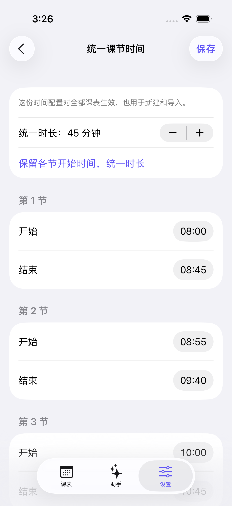

# YIClass iOS

面向 **iOS / iPadOS 26.0 及以上**的 Swift 6、SwiftUI 原生重写。工程中没有 Flutter、Dart、WebView UI 或跨端兼容层。基于 [ddyec/YIClass](https://github.com/ddyec/YIClass) 的 `c8f857828c236706afa745b7aea6435f9a428396` 版本重新实现，沿用原图标与 Logo。

这是原生首版源码，已通过 **Xcode 26 / iOS 26 SDK 应用构建和 15 项核心测试**。早期模拟器运行中，浅色周视图与时间设置导航测试通过；**完整 UI 回归仍未通过**，托管模拟器发生启动进度超时、BackBoard 等待及后续测试启动超时。深色适配已实现，深色截图、真机签名安装和设备端 AI 尚未验收，不能视为正式发布版。结果见 [验证记录](docs/VALIDATION.md)。

## 本次实现

- 原生 TabView、NavigationStack、表单、文件选择与文件导出；悬浮周次控制使用 iOS 26 `GlassEffectContainer` / `glassEffect`，系统标签栏和工具栏采用原生外观。课程内容保持清晰的实色层次。响应减少透明度、减少动态效果与动态字号。
- 默认跟随系统深色模式，可在设置中切换“跟随系统 / 浅色 / 深色”。周视图、课程卡片、助手、设置与表单均使用随系统变化的背景和文字颜色。
- 重做周视图：日期与当前日标识、轻网格、连堂圆角卡片、时间轴、周次切换；保留日视图与列表视图。窄屏会横向滚动，避免周末和大字号时文字被压到不可读。
- 冲突课程全部可见，按重叠组并排排列；不连续节次拆分为多张卡片，单 / 双周按实际周次显示。
- 课程增删改、多条排课、周次选择、配色、多课表切换、学期起点、总周数、周末显示与停课日期。
- 统一课节时间：所有课表共享一份 `TimeProfile`；新建、切换、导入、AI 方案不会替换用户配置。保存会校验重叠、跨日时间与所有现有课程的节次引用。
- 新建空课表继承当前学期的开学日期、周数、周末选项和停课日期；不同学期仍可分别修改学期设置。
- 旧版 JSON 导入与原生 JSON 导出，先预览后导入。新版导出包含课节时间；选择采用文件时间时会明确提示它将影响所有课表。默认保持已有时间。
- 对话助手：模糊描述 → 选择追问选项 / 自由补充 → 1–3 个候选方案 → 查看全部课程与变更 → 应用。支持 Apple Intelligence 本机模型，或自定义 OpenAI 兼容 Chat Completions 接口。
- 截图通过 Vision 在本机识字，结果可编辑后再发送；支持粘贴文本及 UTF-8 TXT / CSV。截图 OCR 不会保留完整二维表格语义，需核对生成结果。不直接解析 XLSX 工作簿。
- AI 结果经结构与范围校验，应用前核对课表和时间是否变化；删除课程单独提示，方案、导入、删除和时间设置可撤销一次。对话只保存在当前进程内。
- 本地原子保存与上一版备份；加载失败不覆盖原文件，支持分享损坏文件、恢复上次备份。API Key 存入设备钥匙串，不进入课表导出。

## 为什么旧版会重置时间

在基线源码中：

1. `lib/views/settings_view/time_settings_page.dart` 只修改当前课表的 `settings.classTimes`。
2. `lib/services/timetable/factory_service.dart` 创建新课表时从常量生成默认时间。
3. `lib/services/file_service.dart` 的 `_settingsToMap` 不导出 `classTimes`，`fromMap` 又忽略输入时间并重新生成默认值。

原生版的 `Timetable` 不再存储 `classTimes`，避免两套时间配置漂移。课表只引用节次，显示时从全局时间表解析。导入文件若课程节次超出当前配置，会报错并要求先完善时间设置，不会偷偷补上默认时间。

## 用 Xcode 打开

需要 **Xcode 26+、iOS 26 SDK**。无需 CocoaPods、XcodeGen 或第三方 Swift 包。

```bash
open YIClass.xcodeproj
```

选择 `YIClass` scheme 和 iOS 26+ 模拟器运行。真机运行时，在 Signing & Capabilities 选择你自己的 Team，并根据需要更改 Bundle Identifier。应用默认标识为 `com.ddyec.YIClassNative`，与 Flutter 旧版隔离安装。

代码组织：

```text
Sources/Core/     模型、日期与排课、导入导出、AI 方案验证（独立 Swift 包）
Sources/App/      SwiftUI 应用、文件持久化、Vision、Foundation Models、Keychain
Tests/Core/       数据与行为回归测试
Tests/UI/         iOS 原生界面冒烟测试与截图附件
scripts/          工程生成、结构检查与构建脚本
YIClass.xcodeproj 已提交的 Xcode 工程和共享 scheme
```

工程成员变化后运行 `python3 scripts/generate_project.py`。生成器仅依赖 Python 标准库；生成结果可重复。

## 验证

```bash
bash scripts/check.sh
# Mac 上进一步执行：
xcodebuild -project YIClass.xcodeproj -scheme YIClass \
  -destination 'platform=iOS Simulator,id=<你的模拟器 UUID>' \
  CODE_SIGNING_ALLOWED=NO test
```

`check.sh` 先检查工程与资源，再执行 `swift test`，在 Mac 上继续构建模拟器 App。GitHub Actions 工作流使用 Xcode 26，执行相同步骤和 UI 冒烟测试，分别保存 `ios-ui-results`（测试结果）与 `ios-screenshots`（界面截图）附件。

托管模拟器出现过首次启动进度请求超时；CI 使用单模拟器运行，并通过 Xcode 对失败测试最多重试一次。原始失败与重试记录保留在 `.xcresult`，持续失败仍使工作流失败。这项设置不代表真机冷启动性能已经验收。

本次已完成：Linux / macOS 上的 15 项 Swift 核心回归测试；Xcode 26.0.1 应用与 UI 测试目标编译；工程结构、资源、隐私清单与协议检查。最新完整 UI 运行因测试启动超时失败，不能宣称 CI 全绿。详细边界见 [docs/VALIDATION.md](docs/VALIDATION.md)。

以下是已实际运行的原生统一时间设置页面，来自 iPhone 17 Pro / iOS 26.0.1 模拟器；不是设计稿：



## AI 使用

“设置 → AI 模式与接口配置”选择处理方式。设备端使用 Foundation Models，需要支持 Apple Intelligence 的设备、地区、语言、开关及已下载模型；iOS 26 本身不保证可用。较大课表或较长对话可能超过设备端模型上下文，需缩短输入或选择自定义服务。模型输出错误时只报错，不应用。

远程模式输入完整 HTTPS Chat Completions 地址、模型名及 Key。支持 OpenAI / DeepSeek 等的兼容接口；Claude、Gemini 原生请求协议不在本版范围内。只有用户点击发送才上传当前课表和对话，不会自动回退至云端。远程请求禁用重定向，避免 Key 随重定向发送到其他地址。

## 从 Flutter 迁移

先从旧应用导出 JSON，再在原生应用的设置中导入。旧版 iOS 导出方法本身尚未实现；如果你只有旧版 iOS 的 Isar 数据库，没有 JSON 文件，本工程不能直接迁移该数据库，需要先从旧应用增加导出或另行转换。

旧版 JSON 未保存自定义课节时间，文件中不存在的信息无法恢复。请在原生版统一时间中补设一次，此后新建和导入均会沿用。

本版优先覆盖课程管理、原生界面、时间一致性与对话方案。旧 Flutter 的教务网站脚本仓库、直接网页导入、课程本地通知尚未迁入，不能声称与旧版全部功能等价。没有接入统计 SDK、广告或开发者服务器。隐私清单标记了用户主动使用自定义 AI 时可能发送的用户内容；实际远程服务的留存政策由用户选择的供应商决定。

## 新仓库状态

本目录与旧项目分离，旧仓库未作修改。GitHub 连接创建仓库时返回 `Resource not accessible by integration (createRepository)`；用户随后手动创建了 [ddyec/YIClass-iOS](https://github.com/ddyec/YIClass-iOS)，该仓库用作本次原生重写的远程仓库。

源码已推送到该仓库的 `main` 分支。后续可直接从新仓库克隆：

```bash
git clone https://github.com/ddyec/YIClass-iOS.git
cd YIClass-iOS
open YIClass.xcodeproj
```

## 开源协议

Apache License 2.0。保留原项目 `Copyright 2025 wykwey`、原始图标与 Logo。见 [LICENSE](LICENSE) 与 [NOTICE](NOTICE)。
